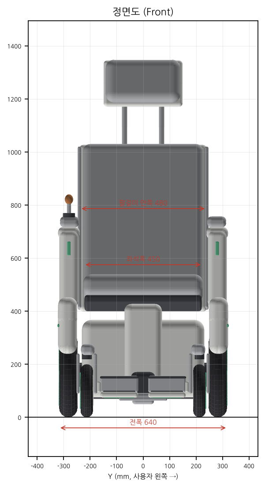
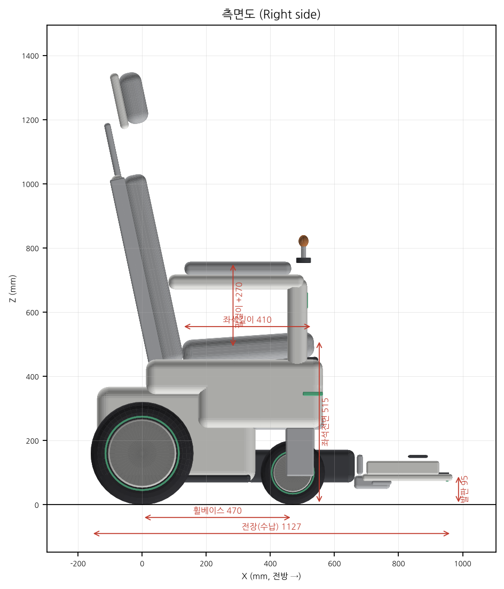
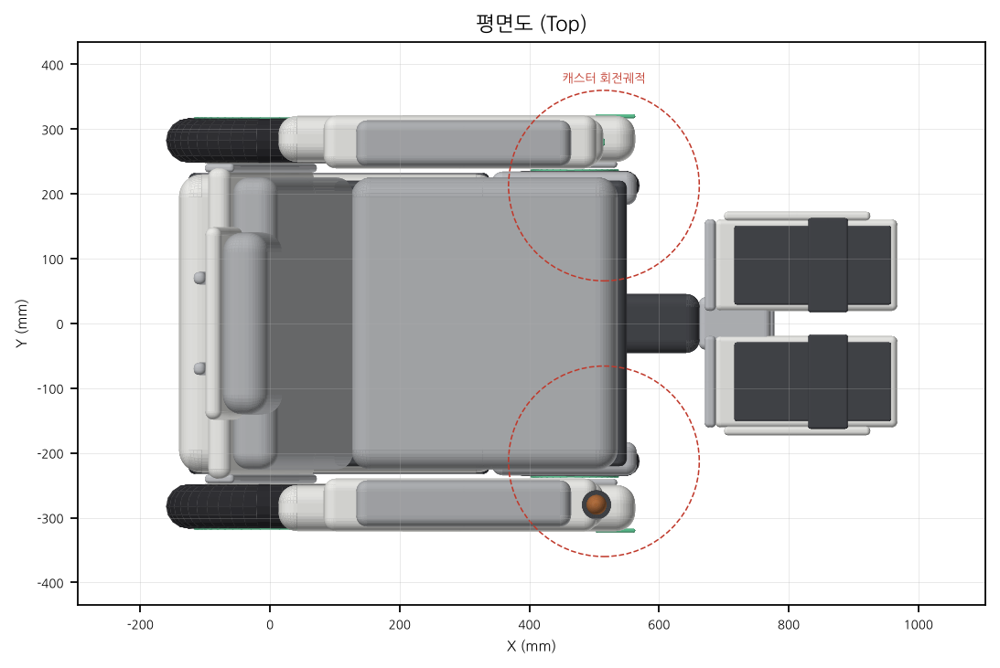
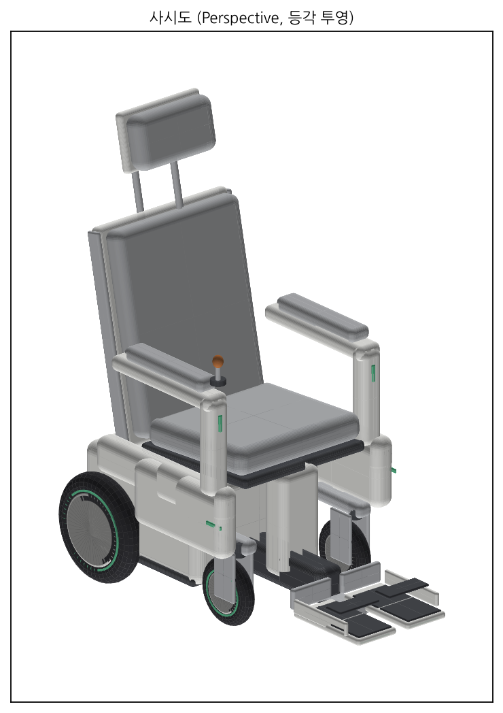
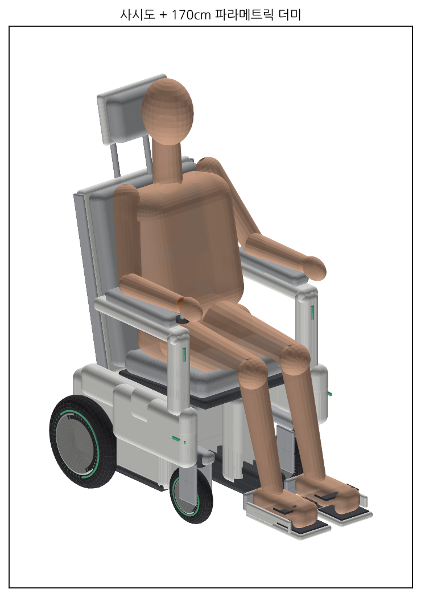
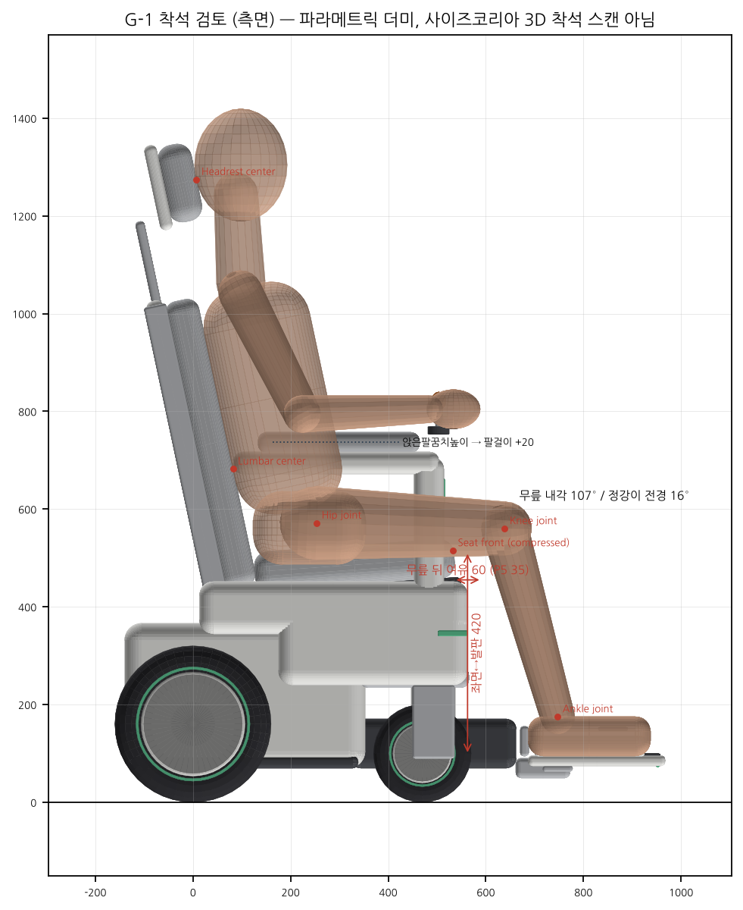
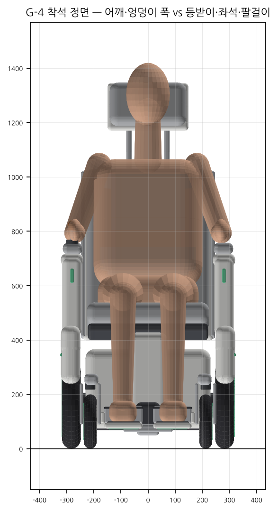
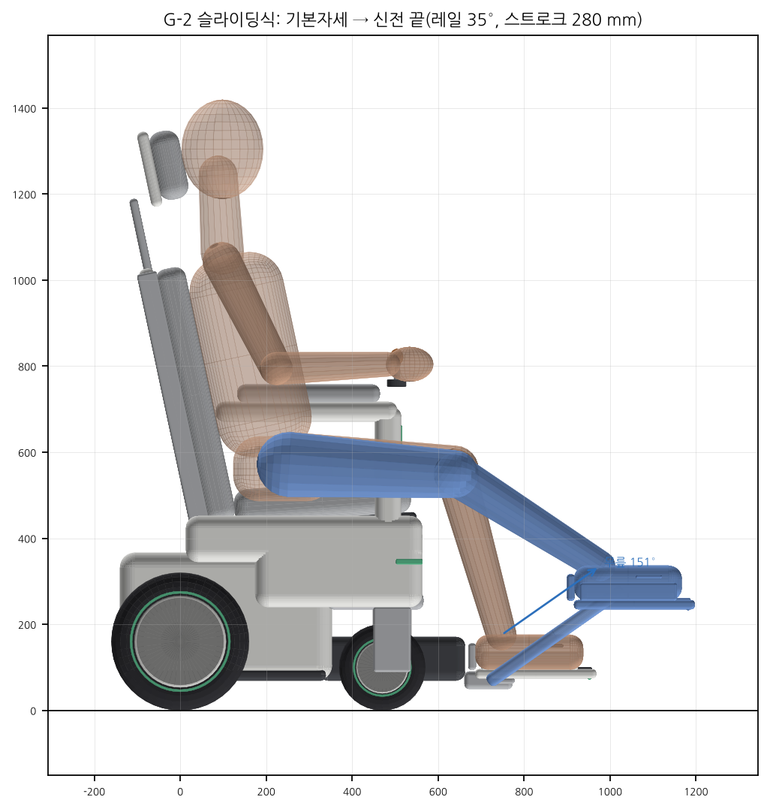
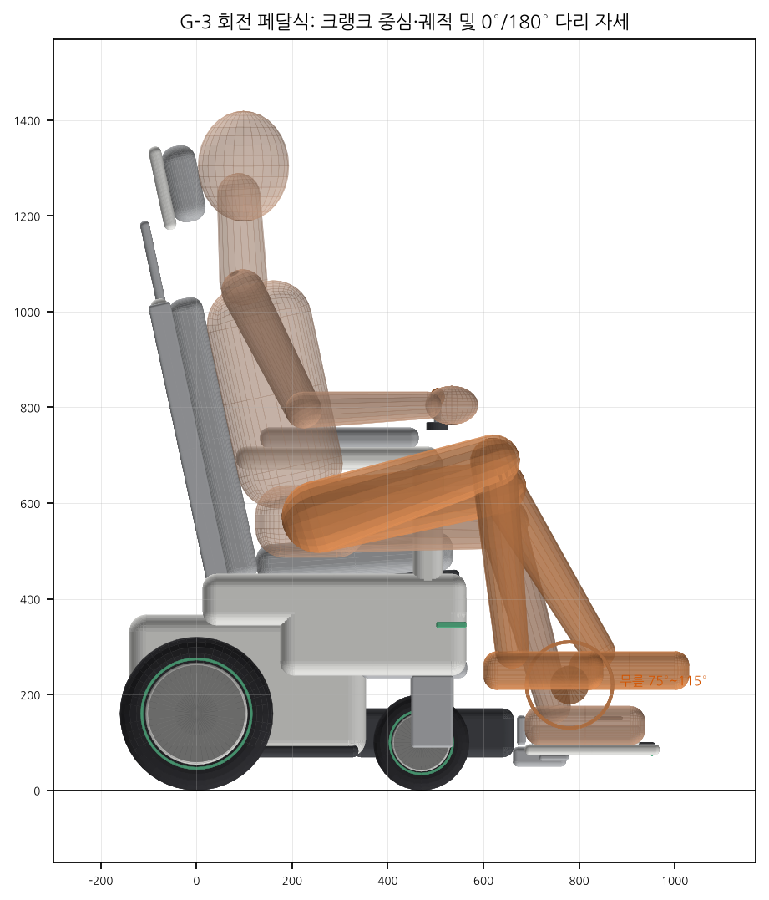

# 재활휠체어 1:1 기본 볼륨 모델 — 170cm 성인 기준 (Size Korea 연동형)

> **현재 상태:** 사이즈코리아 원자료에 접근하지 못해(이 실행 환경에서 sizekorea.kats.go.kr 접속 차단) 모든 인체치수는 **[임시 가정값]**입니다. 사이즈코리아 공식 수치가 아닙니다. 원자료를 받아 `sizekorea_analysis.py`를 실행하면 값이 **[공식 측정값]**으로 교체되고 모델·도면·표가 다시 계산됩니다.

좌표계: 원점 = 바닥·차체 중심선·후륜 차축 아래, +X 전방, +Y 사용자 왼쪽, +Z 위. 단위 mm.


## A. 사이즈코리아 인체치수 분석표

### A-1. 조사 대상 자료 및 접근 결과

| 자료 | 상태 | 필요 조치 |
|---|---|---|
| 제8차 한국인 인체치수조사(2020~2024) 성인 직접측정 원자료 | 접근 불가(네트워크 차단) | 회원가입 → 자료 신청·승인 후 다운로드 |
| 2024 휠체어 사용 척수손상 장애인 측정 자료 | 접근 불가 — 존재·공개범위 미확인 | 사이트 '자료실/인체치수 데이터' 에서 공개 여부 확인 |
| 제8차 3D 표준인체형상 | 접근 불가 | 3D 형상 자료 신청 → OBJ/STL 등을 Rhino 'Human Reference' 레이어에 Import |


### A-2. 항목별 입력값 (모두 교체 대상)

| 항목(사이즈코리아 명칭) | 원자료 수록 | 값 | 단위 | 구분 | 비고 | 출처·조건·산출방법 |
|---|---|---|---|---|---|---|
| 앉은키 | 있음 | 905 | mm | [임시 가정값] | P50 자리표시값 | 출처 없음 — 모델링용 자리표시값 |
| 앉은어깨높이 | 있음 | 590 | mm | [임시 가정값] | P50 자리표시값 | 출처 없음 — 모델링용 자리표시값 |
| 앉은팔꿈치높이 | 있음 | 250 | mm | [임시 가정값] | P50 자리표시값 | 출처 없음 — 모델링용 자리표시값 |
| 앉은엉덩이너비 | 있음 | 370 | mm | [임시 가정값] | P50 자리표시값 | 출처 없음 — 모델링용 자리표시값 |
| 앉은엉덩이오금수평길이 | 있음 | 470 | mm | [임시 가정값] | P50 자리표시값 | 출처 없음 — 모델링용 자리표시값 |
| 앉은엉덩이무릎수평길이 | 있음 | 570 | mm | [임시 가정값] | P50 자리표시값 | 출처 없음 — 모델링용 자리표시값 |
| 앉은오금높이 | 있음 | 410 | mm | [임시 가정값] | P50 자리표시값 | 출처 없음 — 모델링용 자리표시값 |
| 앉은무릎높이 | 있음 | 520 | mm | [임시 가정값] | P50 자리표시값 | 출처 없음 — 모델링용 자리표시값 |
| 앉은넙다리높이 | 있음 | 150 | mm | [임시 가정값] | P50 자리표시값 | 출처 없음 — 모델링용 자리표시값 |
| 어깨너비 | 있음 | 380 | mm | [임시 가정값] | P50 자리표시값 | 출처 없음 — 모델링용 자리표시값 |
| 발길이 | 있음 | 250 | mm | [임시 가정값] | P50 자리표시값 | 출처 없음 — 모델링용 자리표시값 |
| 발너비 | 있음 | 100 | mm | [임시 가정값] | P50 자리표시값 | 출처 없음 — 모델링용 자리표시값 |
| 머리너비 | 있음 | 160 | mm | [임시 가정값] | P50 자리표시값 | 출처 없음 — 모델링용 자리표시값 |
| 머리길이 | 확인 필요 | 190 | mm | [임시 가정값] | P50 자리표시값 | 출처 없음 — 모델링용 자리표시값 |
| 머리수직길이 | 확인 필요 | 230 | mm | [임시 가정값] | P50 자리표시값 | 출처 없음 — 모델링용 자리표시값 |
| 앉은눈높이 | 있음 | 790 | mm | [임시 가정값] | P50 자리표시값 | 출처 없음 — 모델링용 자리표시값 |
| 어깨최대너비 | 확인 필요 | 450 | mm | [임시 가정값] | 명칭·수록 여부 확인 필요 | 출처 없음 — 모델링용 자리표시값 |
| 앉은팔꿈치사이너비 | 확인 필요 | 470 | mm | [임시 가정값] | 명칭·수록 여부 확인 필요 | 출처 없음 — 모델링용 자리표시값 |
| 팔꿈치손목길이 | 확인 필요 | 260 | mm | [임시 가정값] | 명칭·수록 여부 확인 필요 | 출처 없음 — 모델링용 자리표시값 |
| 앉은엉덩이너비_P95 | - | 400 | mm | [임시 가정값] | P95 자리표시값(좌석 폭 수용) | 출처 없음 |
| 앉은엉덩이오금수평길이_P5 | - | 445 | mm | [임시 가정값] | P5 자리표시값(무릎 뒤 여유 검토) | 출처 없음 |
| 앉은오금높이_P5 | - | 390 | mm | [임시 가정값] | P5 자리표시값 | 출처 없음 |


'원자료 수록' 열의 '확인 필요'는 해당 명칭이 8차 직접측정 항목표에 있는지 확인하지 못했다는 뜻입니다. 목·머리 지지용 치수 중 **'앉은후두부높이' 같은 항목은 일반 측정항목에 없을 가능성이 높아** `앉은키 − 정수리~후두부 오프셋(110, 임시)`으로 대체했습니다.


### A-3. 168~172cm 집단 남녀·연령별 비교 및 5·50·95백분위수

원자료 없이 계산할 수 없어 **표를 비워 두었습니다.** 원자료를 받은 뒤 아래 명령을 실행하면 `out/sizekorea_170_summary.csv`에 항목 × (전체 / 성별 / 성별×연령대)별 n·평균·SD·P5·P50·P95가 생성됩니다. 셀 표본이 30명 미만이면 '참고용'으로 표시합니다.

```bash
python sizekorea_analysis.py <다운로드한_원자료.xlsx> --hmin 1680 --hmax 1720 --age 20-69
```

```bash
python export_and_render.py && python make_report.py
```

**직접 받아야 할 자료와 절차**

1. https://sizekorea.kats.go.kr 회원가입·로그인
2. 인체치수 데이터 → 제8차 직접측정 **원자료(개인별 raw data)** 신청. 통계표만 받으면 신장 168~172cm 집단을 추출할 수 없으므로 개인별 자료가 필요합니다.
3. 같은 메뉴에서 2024 휠체어 사용자(척수손상) 측정 자료의 공개 여부와 항목표를 확인합니다. 착석 자세 치수가 들어 있으면 일반 성인 값보다 이 값을 우선 적용합니다.
4. 3D 표준인체형상(착석형이 있는지 확인)을 신청하고 받은 형상을 Rhino에서 Import합니다. 서 있는 형상을 회전해 앉힌 것은 착석 스캔과 같다고 볼 수 없습니다.
5. 받은 파일의 열 이름(키, 성별, 나이, 각 항목)이 스크립트 별칭과 다르면 `--map 항목=열이름`으로 지정합니다.


## B. 인체치수 → 제품치수 변환 계산표

| 그룹 | 키 | 값 | 단위 | 구분 | 계산식/근거 |
|---|---|---|---|---|---|
| 좌석 | seat_width | 450 | mm | [설계 산출값] | 앉은엉덩이너비(P95) + 2×좌우여유 |
| 좌석 | seat_depth | 410 | mm | [설계 산출값] | 앉은엉덩이오금수평길이 − 오금여유 |
| 좌석 | knee_clear_P50 | 60 | mm | [설계 산출값] | P50 오금 여유 |
| 좌석 | knee_clear_P5 | 35 | mm | [설계 산출값] | P5 오금 여유(≥25 권장) |
| 좌석 | thigh_support_ratio | 87.2 | % | [설계 산출값] | 좌석깊이 / 엉덩이오금길이 |
| 좌석 | seat_front_h | 515 | mm | [설계 산출값] | 발판최저상면 + 앉은오금높이 + 신발 |
| 좌석 | cushion_thk | 80 | mm | [임시 가정값] |  |
| 좌석 | cushion_compress | 25 | mm | [임시 가정값] | 실측 필요 |
| 좌석 | front_round_r | 30 | mm | [임시 가정값] |  |
| 좌석 | seat_rear_h | 486.4 | mm | [설계 산출값] | 좌석전면높이 − 깊이×sin(경사) |
| 좌석 | seat_rear_h_uncompressed | 511.4 | mm | [설계 산출값] | 비착석 시 좌면 후부 높이 |
| 인체링크 | L1_thigh | 385.2 | mm | [설계 산출값] | 고관절→무릎관절 (엉덩이무릎길이·오프셋 기반) |
| 인체링크 | L2_shank | 400 | mm | [설계 산출값] | 무릎관절→발목 = 오금높이 + 45 + 신발 − 80 |
| 발판 | plate_top_h | 95 | mm | [설계 산출값] | 좌석전면높이 − 오금높이 − 신발 + 상향량 |
| 인체링크 | shank_incline_deg | 15.7 | ° | [설계 산출값] | 착석 기본자세 정강이 전경각 |
| 바퀴·차체(구조 가정 기반) | caster_swivel_envelope_r | 147.1 | mm | [설계 산출값] | √((트레일+R)²+(W/2)²) |
| 바퀴·차체(구조 가정 기반) | wheelbase | 470 | mm | [임시 가정값] | 목표 휠베이스(후륜축↔캐스터축) |
| 바퀴·차체(구조 가정 기반) | caster_swivel_x | 515 | mm | [설계 산출값] | 휠베이스 + 트레일 |
| 좌석 | seat_rear_x | 123.6 | mm | [설계 산출값] | 발판 뒤꿈치 = 스위블x + 궤적반경 + 간격 에서 역산 |
| 좌석 | seat_front_x | 532.6 | mm | [설계 산출값] |  |
| 인체링크 | knee_angle_seated | 107.4 | ° | [설계 산출값] | 착석 기본자세 무릎 내각 |
| 인체링크 | thigh_angle_seated | -1.7 | ° | [설계 산출값] | 착석 허벅지 각(수평 기준, +상향) |
| 등받이·헤드레스트 | seat_back_angle | 98 | ° | [설계 산출값] | 90 + 후경각 − 좌면경사 |
| 등받이·헤드레스트 | back_height | 560 | mm | [설계 산출값] | 앉은어깨높이 − 30 (등받이 방향 거리) |
| 등받이·헤드레스트 | back_width | 450 | mm | [설계 산출값] | = 좌석 폭 (어깨너비 P50 보다 넓음 확인) |
| 등받이·헤드레스트 | back_width_vs_shoulder | 70 | mm | [설계 산출값] | 등받이폭 − 어깨너비 |
| 등받이·헤드레스트 | lumbar_center | 200 | mm | [임시 가정값] | 문헌(요추 L3–L4) 확인 필요 |
| 등받이·헤드레스트 | shoulder_support | 502 | mm | [설계 산출값] | 앉은어깨높이 × 0.85 |
| 등받이·헤드레스트 | headrest_center_s | 795 | mm | [설계 산출값] | 앉은키 − 정수리~후두부 (등받이 방향) |
| 등받이·헤드레스트 | headrest_w | 280 | mm | [설계 산출값] | 머리너비 + 2×60 |
| 등받이·헤드레스트 | headrest_h | 160 | mm | [임시 가정값] |  |
| 등받이·헤드레스트 | headrest_t | 70 | mm | [임시 가정값] |  |
| 등받이·헤드레스트 | headrest_fwd_offset | 50 | mm | [임시 가정값] | 등받이면 대비 전방(조절식 필요) |
| 등받이·헤드레스트 | headrest_gap_back | 155 | mm | [설계 산출값] | 등받이 상단~헤드레스트 하단 |
| 팔걸이·조이스틱 | armrest_h_above_seat | 270 | mm | [설계 산출값] | 앉은팔꿈치높이 + 20 (압축 좌면 기준) |
| 팔걸이·조이스틱 | armrest_top_abs | 756.4 | mm | [설계 산출값] | 바닥 기준 |
| 팔걸이·조이스틱 | armrest_inner_gap | 480 | mm | [설계 산출값] | 좌석폭 + 2×15 |
| 팔걸이·조이스틱 | armrest_len | 330 | mm | [임시 가정값] |  |
| 팔걸이·조이스틱 | armrest_pad_w | 70 | mm | [임시 가정값] |  |
| 팔걸이·조이스틱 | elbow_zone | 등받이면 +40 ~ +200 |  | [임시 가정값] | 팔꿈치 지지 구간 |
| 팔걸이·조이스틱 | joystick_from_back | 380 | mm | [설계 산출값] | 팔꿈치(등받이+60) + 팔꿈치손목길이 + 그립 |
| 팔걸이·조이스틱 | transfer_opening | 410 | mm | [설계 산출값] | 팔걸이 스윙업 시 측면 이승 개구 길이 ≈ 좌석깊이 |
| 바퀴·차체(구조 가정 기반) | rear_track_cc | 565 | mm | [설계 산출값] | 팔걸이 외곽에 후륜 외곽을 맞춤 |
| 바퀴·차체(구조 가정 기반) | rear_wheel_D_W | 320 × 75 | mm | [임시 가정값] |  |
| 바퀴·차체(구조 가정 기반) | caster_D_W | 200 × 50 | mm | [임시 가정값] |  |
| 바퀴·차체(구조 가정 기반) | front_track_cc | 426 | mm | [설계 산출값] | 2×(팔걸이외곽 + 허용돌출 − 회전궤적반경) |
| 바퀴·차체(구조 가정 기반) | caster_env_vs_spine | 20.7 | mm | [설계 산출값] | 캐스터 궤적 안쪽 ↔ 중앙 스파인 간격(≥15) |
| 바퀴·차체(구조 가정 기반) | overall_width | 640 | mm | [설계 산출값] | max(팔걸이, 후륜, 캐스터 후향 정지) ×2 |
| 바퀴·차체(구조 가정 기반) | overall_width_caster_swept | 720 | mm | [설계 산출값] | 캐스터 90° 회전 시 최대 폭 |
| 바퀴·차체(구조 가정 기반) | ground_clear | 70 | mm | [임시 가정값] |  |
| 발판 | plate_len | 280 | mm | [설계 산출값] | 발길이 + 30 |
| 발판 | plate_w | 140 | mm | [설계 산출값] | 발너비 + 40 |
| 발판 | plate_gap | 40 | mm | [임시 가정값] |  |
| 발판 | plate_center_y | 90 | mm | [설계 산출값] |  |
| 발판 | plate_heel_x | 687.1 | mm | [설계 산출값] |  |
| 발판 | plate_bottom_h | 75 | mm | [설계 산출값] | 발판 최저 지상고(기본자세) |
| 바퀴·차체(구조 가정 기반) | overall_length_stowed | 1127 | mm | [설계 산출값] | 후륜 후단(또는 등받이 후면) ~ 발판 전단 |
| 발판 | plate_y_outer | 160 | mm | [설계 산출값] |  |
| 발판 | caster_env_inner_y | 65.7 | mm | [설계 산출값] |  |
| 재활-슬라이딩식 | rail_angle | 35 | ° | [설계 산출값] | 도달 가능한 최소 스트로크 레일각(수평 기준) |
| 재활-슬라이딩식 | stroke | 280 | mm | [설계 산출값] | 기본자세 → 무릎 내각 150° 까지 |
| 재활-슬라이딩식 | knee_range | 107° → 151° |  | [설계 산출값] |  |
| 재활-슬라이딩식 | plate_top_at_end | 256 | mm | [설계 산출값] | 신전 끝 발판 상면 높이 |
| 재활-슬라이딩식 | plate_front_x_at_end | 1197 | mm | [설계 산출값] | 신전 끝 발판 전단 x |
| 재활-회전페달식 | crank_r | 90 | mm | [임시 가정값] |  |
| 재활-회전페달식 | crank_center_x | 780 | mm | [설계 산출값] | 조건 만족 최소 전방 위치(그리드 10mm) |
| 재활-회전페달식 | crank_center_h | 220 | mm | [설계 산출값] |  |
| 재활-회전페달식 | knee_range | 75° ~ 115° |  | [설계 산출값] | 1회전 중 무릎 내각 |
| 재활-회전페달식 | pedal_low_h | 110 | mm | [설계 산출값] | 페달 최저점 지상고 |
| 바퀴·차체(구조 가정 기반) | pivot_turn_diameter | 1961 | mm | [설계 산출값] | 후륜 차동 제자리회전 시 최외곽점 궤적 직경(개략, ISO 7176-5 시험 대체 불가) |
| 바퀴·차체(구조 가정 기반) | cg_x_est | 229 | mm | [임시 가정값] | 사용자CG(고관절+60)·차체CG(휠베이스 35%) 가중평균 — 실측 필요 |
| 바퀴·차체(구조 가정 기반) | rear_tip_margin | 229 | mm | [설계 산출값] | CG ~ 후륜 접지점 수평거리(정적) |
| 바퀴·차체(구조 가정 기반) | front_tip_margin | 241 | mm | [설계 산출값] | CG ~ 캐스터 접지점 수평거리(정적) |


인체 링크 모델 오프셋(모두 [임시 가정값]):


| 키 | 값(mm) | 의미 |
|---|---|---|
| hip_fwd_from_buttock | 130 | 엉덩이 후면 → 고관절 중심 수평거리 |
| hip_above_seat | 85 | 압축 좌면 → 고관절 중심 높이 |
| knee_pivot_behind_front | 55 | 무릎 앞면 → 무릎관절 중심 |
| knee_pivot_above_popliteal | 45 | 오금 하면 → 무릎관절 중심 |
| ankle_above_sole | 80 | 신발 밑창 → 발목관절 중심(신발 포함) |
| ankle_fwd_of_heel | 60 | 뒤꿈치 후면 → 발목관절 중심 |
| shoe_allowance | 25 | 신발 밑창 두께 |
| occiput_below_vertex | 110 | 정수리 → 후두부 최돌출점 수직거리 |
| occiput_fwd_of_back | 50 | 등받이면 → 후두부 전방 오프셋(흉추 후만) |
| torso_depth | 220 | 앉은 몸통 두께 |


## C. 파트별 최종 치수표 (mm, 모델 바운딩박스 실측)

| part | xmin | ymin | zmin | xmax | ymax | zmax | L(X) | W(Y) | H(Z) |
|---|---|---|---|---|---|---|---|---|---|
| Seat Cushion | 100.0 | -225.0 | 400.3 | 549.6 | 225.0 | 537.9 | 449.6 | 450.0 | 137.6 |
| Backrest | -99.5 | -246.0 | 398.9 | 127.3 | 246.0 | 1029.5 | 226.8 | 492.0 | 630.6 |
| Headrest | -117.2 | -148.0 | 997.1 | 18.3 | 148.0 | 1347.1 | 135.5 | 296.0 | 350.0 |
| Left Armrest | 83.6 | 240.0 | 416.4 | 515.6 | 320.0 | 756.4 | 432.0 | 80.0 | 340.0 |
| Right Armrest | 83.6 | -320.0 | 416.4 | 525.6 | -240.0 | 839.4 | 442.0 | 80.0 | 423.0 |
| Side Body | 13.6 | -322.0 | 240.0 | 562.6 | 322.0 | 451.4 | 549.0 | 644.0 | 211.4 |
| Lower Chassis | -140.0 | -243.0 | 70.0 | 565.0 | 243.0 | 366.4 | 705.0 | 486.0 | 296.4 |
| Rear Wheels | -160.0 | -317.8 | 0.0 | 160.0 | 317.8 | 320.0 | 320.0 | 635.5 | 320.0 |
| Front Casters | 370.0 | -250.9 | 0.0 | 570.0 | 250.9 | 260.0 | 200.0 | 501.7 | 260.0 |
| Rehabilitation Mechanism | 322.9 | -90.0 | 50.0 | 777.1 | 90.0 | 426.4 | 454.2 | 180.0 | 376.4 |
| Left Foot Platform | 671.1 | 18.0 | 73.0 | 967.1 | 172.0 | 155.0 | 296.0 | 154.0 | 82.0 |
| Right Foot Platform | 671.1 | -172.0 | 73.0 | 967.1 | -18.0 | 155.0 | 296.0 | 154.0 | 82.0 |
| Human Reference | 3.1 | -308.0 | 95.0 | 937.1 | 308.0 | 1419.0 | 934.1 | 616.0 | 1324.0 |


주요 파트 파라미터(구분 포함)


| 파트 | 항목 | 값 | 구분 |
|---|---|---|---|
| Seat Cushion | 유효 폭×깊이×두께 | 450 × 410 × 80 | 설계 산출 / 두께 임시 |
| Seat Cushion | 좌면 높이 전/후(압축) | 515 / 486 | 설계 산출 |
| Backrest | 높이(좌면 기준)×폭, 각도 | 560 × 450, 좌면-등받이 98° | 설계 산출 |
| Headrest | 폭×높이×두께, 중심(등받이 방향) | 280 × 160 × 70, 795 | 폭·중심 설계 산출 / 높이·두께 임시 |
| Armrests | 좌면 위 높이, 안쪽 간격, 길이×폭 | 270, 480, 330 × 70 | 높이·간격 설계 산출 / 길이·폭 임시 |
| Rear Wheels | 직경×폭, 트레드 | 320 × 75, 565 | 임시(구조) |
| Front Casters | 직경×폭, 트레드, 트레일 | 200 × 50, 426, 45 | 임시(구조) |
| Chassis | 전폭 / 전장(수납) / 휠베이스 / 지상고 | 640 / 1127 / 470 / 70 | 설계 산출 + 임시 |
| Foot Platforms | 길이×폭×두께, 간격, 상면 높이 | 280 × 140 × 20, 40, 95 | 설계 산출 / 간격·두께 임시 |


파트별 치수는 `wc_model.py`의 `OVERRIDES` 딕셔너리로 다른 파트와 상관없이 바꿀 수 있습니다. 예: `OVERRIDES["Headrest"] = {"w": 300, "center_s": 780}`.


## D. Rhino 8 스크립트 / E. 3D 모델 파일

| 파일 | 내용 |
|---|---|
| `wc_model.py` | **Rhino 8 ScriptEditor(Python 3)에서 바로 실행.** RhinoCommon으로 파트별 레이어 메시, 기준점 TextDot, 바운딩박스, MeshMeshFast 교차선(`_Interference` 레이어)을 만듭니다. 일반 Python에서는 계산 모듈로 쓰입니다. |
| `export_and_render.py` | Rhino 없이 rhino3dm으로 `.3dm`을 내보내고 도면 PNG와 CSV를 생성합니다. |
| `sizekorea_analysis.py` | 원자료에서 신장 168~172cm를 추출해 성별·연령대별 통계를 내고 모델 입력값(JSON)을 생성합니다. |
| `out/RehabWheelchair_170cm_1to1.3dm` | 1:1 mm, 메시, 18개 레이어(13개 파트, 재활 자세 2개, 기준점, BBox) |


Rhino 사용: `ScriptEditor` → `wc_model.py` 열기 → Run. 같은 폴더에 `anthropometry_sizekorea.json`이 있으면 자동으로 반영됩니다.

**구현하지 않은 것:** NURBS/SubD 서피스, 실제 필렛 엣지, 힌지·슬라이드 메커니즘 구동, 구조 해석. 형상은 라운드 박스·회전체 메시로 만든 기본 볼륨입니다. 정밀 형상은 이 볼륨을 기준으로 다시 모델링해야 합니다. Rhino 밖에서 실행하는 간섭 검사는 부품별 AABB 근사이며, 실제 형상 간섭은 Rhino의 MeshMeshFast 결과로 확인해야 합니다. 이 컨테이너에는 Rhino가 없어 Rhino 실행부는 직접 실행해 보지 못했습니다.


## F. 정면도·측면도·평면도·사시도










## G. 170cm 더미 착석 검토

더미는 위 인체치수(임시값)로 만든 **파라메트릭 캡슐·박스 더미**입니다. 사이즈코리아 3D 착석 스캔이 아닙니다.













### 착석 검토 결과

| 항목 | 결과 | 판정/메모 |
|---|---|---|
| 엉덩이-좌석 접촉 | 압축 좌면(쿠션 25mm 압축 가정)에 골반 하면이 닿도록 배치 | 압축량 실측 필요 |
| 허벅지 지지 | 좌석깊이 410 = 엉덩이오금길이의 87.2% | OK(가정값 기준) |
| 무릎 뒤 여유 | P50 60 / P5 35 mm | OK(≥25) |
| 발판까지 거리 | 좌석 전면 ↔ 발판 상면 420 mm, 정강이 전경 16°, 무릎 내각 107° | 발판 높이 조절 ±30 권장 |
| 팔꿈치-팔걸이 | 팔걸이 = 앉은팔꿈치높이 + 20 | OK(가정값 기준) |
| 등-등받이 | 등받이 높이 560(어깨 −30), 요추 200, 견갑 502 | 요추 위치 문헌·실측 확인 |
| 후두부-헤드레스트 | 중심 795 (등받이 방향), 전방 오프셋 50 | 상하 ±50·전후 ±40 조절식 권장 |


### 간섭·여유 검사 (`out/checks.csv`)

| type | item | result | judgement |
|---|---|---|---|
| Clearance | 발판 뒤꿈치지지대 ↔ 캐스터 회전궤적(평면) | 17 mm | OK |
| Clearance | 발판 최저 지상고(기본자세) | 75 mm | OK |
| Clearance | 무릎 뒤 여유 P50 / P5 | 60 / 35 mm | OK |
| Width | 전폭 | 640 mm | OK |
| Rehab | 기본자세: 무릎 107°, 허벅지 -2° | 정강이↔Rehabilitation Mechanism/spine housing 최소 48 mm (부품별 AABB 근사) | OK |
| Rehab | 슬라이딩 신전 끝: 무릎 151°, 허벅지 -3° | 정강이↔Rehabilitation Mechanism/front riser 최소 112 mm (부품별 AABB 근사) | OK |
| Rehab | 페달 0°: 무릎 112°, 허벅지 9° | 정강이↔Rehabilitation Mechanism/front riser 최소 142 mm (부품별 AABB 근사) | OK |
| Rehab | 페달 90°: 무릎 85°, 허벅지 27° | 정강이↔Rehabilitation Mechanism/front riser 최소 131 mm (부품별 AABB 근사) | OK |
| Rehab | 페달 180°: 무릎 78°, 허벅지 18° | 정강이↔Rehabilitation Mechanism/front riser 최소 63 mm (부품별 AABB 근사) | OK |
| Rehab | 페달 270°: 무릎 104°, 허벅지 2° | 정강이↔Rehabilitation Mechanism/spine housing 최소 56 mm (부품별 AABB 근사) | OK |


BBox 겹침 목록(조립 접합부를 포함하는 거친 검사)은 `out/checks.csv`에 있습니다.


### 재활 발판 — 두 방식 비교

| 구분 | 전후 슬라이딩식 | 회전 페달식 |
|---|---|---|
| 운동 | 발판이 경사 레일을 따라 전진·상승(레그프레스형) | 크랭크 원운동(사이클형) |
| 산출 배치 | 레일 35°, 스트로크 280 mm | 크랭크 중심 x=780, h=220, r=90 |
| 무릎 내각 범위 | 107° → 151° | 75° ~ 115° |
| 전방 점유 | 신전 끝 발판 전단 x=1197 | 페달 궤적 전단 x=1020 |
| 구조 | 중앙 스파인 + 경사 레일 + 캐리지(직선 액추에이터) | 중앙 스파인 + 크랭크 하우징(모터/저항), 좌우 페달 위상차 180° |
| 발 이탈 방지 | 뒤꿈치 지지대 + 외측 가드 + 발등 스트랩 | 페달 스트랩/힐컵 필수, 회전 중 발 미끄럼 위험 |
| 수납 | 레일 후퇴 시 일반 발판으로 사용 | 페달을 발판 위치로 고정하거나 교체 모듈 |


공통 차체(중앙 스파인, 전면 라이저, 캐리지 바)를 먼저 모델링했고, 두 방식은 `Rehab Pose - *` 레이어에 참조 형상으로만 넣었습니다. 탐색 조건(무릎 내각 75~150°, 허벅지가 좌면 아래로 내려가지 않음, 페달 최저 지상고 50mm, 캐스터 궤적 회피)은 모두 **[임시 가정값]**입니다. 재활 효과와 안전성을 보장하지 않습니다.


## H. 인체공학 검증이 필요한 부분과 설계 한계

1. **인체치수 전부가 임시값입니다.** 사이즈코리아 원자료로 교체하기 전에는 이 모델로 치수를 확정하면 안 됩니다.
2. 170cm만 기준으로 하면 남녀 체형 차이(엉덩이 너비, 앉은키 비율)가 큽니다. 원자료로 남녀를 나눠 보고, 폭 치수는 큰 쪽의 P95, 길이 치수는 작은 쪽의 P5로 검토하세요.
3. 휠체어 사용자(척수손상)는 근위축·자세 변형·욕창 위험 때문에 일반 성인과 치수 분포가 다를 수 있습니다. 2024 휠체어 사용자 자료를 우선 적용해야 합니다.
4. 관절 중심 오프셋(LINK), 쿠션 압축량, 요추 지지 위치, 후두부 오프셋은 문헌 확인과 실측이 필요합니다.
5. 바퀴 직경, 트레일, 휠베이스, 질량, CG는 구조·안정성 가정입니다. ISO 7176-1(정적 안정성), ISO 7176-2(동적 안정성), ISO 7176-5(치수·회전 공간) 시험이나 해석으로 확인해야 합니다. 제자리 회전 직경 1961 mm는 개략 계산값입니다.
6. 슬라이딩식은 무릎을 150°까지 펴려면 레일을 35° 정도로 경사지게 해야 합니다. 의자 기울기·등받이 리클라인과 연동할지 검토가 필요합니다. 신전 시 전장이 늘어나므로 실내 회전 공간도 다시 확인해야 합니다.
7. 회전 페달식은 캐스터를 피하고 무릎·고관절 각도 조건을 만족하는 크랭크 위치를 찾았지만, 발 고정·근긴장(경직)·관절 가동범위는 임상 검증 대상입니다.
8. 팔걸이로 측면 이승을 하려면 스윙업 또는 탈착 구조가 필요합니다(현재는 형상만 있고 힌지는 없음).
9. 캐스터를 90° 돌리면 폭이 720 mm까지 늘어납니다(정지 시 전폭 640 mm).
10. 메시 기반 기본 볼륨이라 표면 품질, 엣지 연결, CMF는 컨셉 수준입니다.
